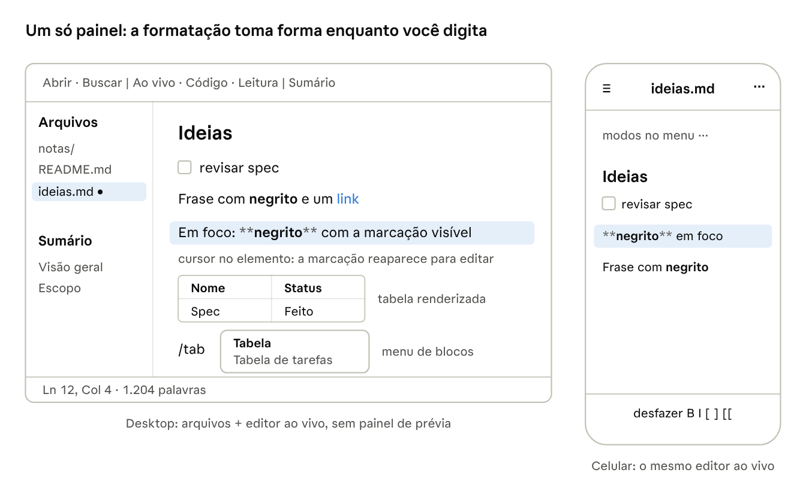
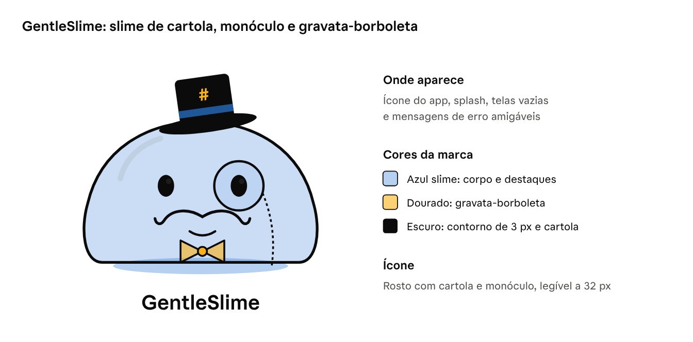
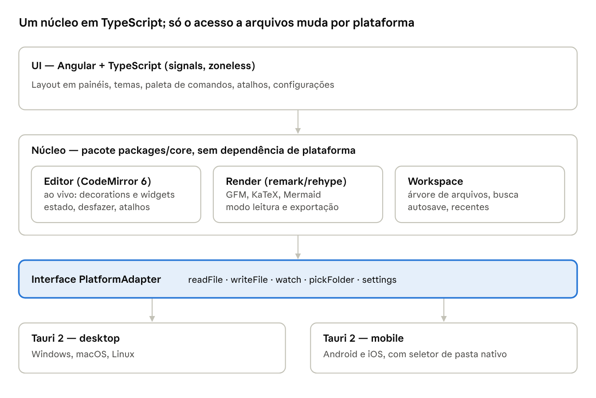
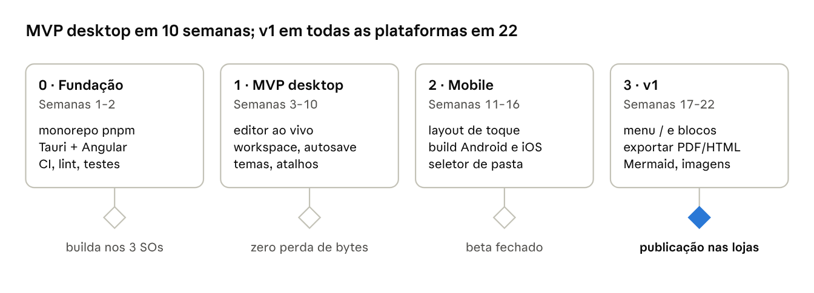

# Spec — GentleSlime: Md reader and editor

Nov 7, 2026 · @Felipe

## Visão geral

O **GentleSlime — Md reader and editor** é um editor de Markdown open source (licença MIT) e local-first que roda em Windows, macOS, Linux, Android e iOS a partir de um único código-base. Os arquivos ficam como `.md` puros no disco do usuário: nada de banco proprietário, nada de lock-in.

**Problema.** Editores existentes ou são bons no desktop e fracos no celular, ou exigem conta e nuvem própria, ou escondem o Markdown atrás de um editor rico que corrompe a formatação.

**Público-alvo.**

- Desenvolvedores e escritores técnicos que mantêm READMEs, docs e notas em repositórios
- Estudantes e pesquisadores que fazem anotações com fórmulas e tabelas
- Quem quer ler `.md` no celular com boa tipografia

**Princípios do produto.**

1. **Arquivo é a verdade** — o que está no disco é exatamente o que o usuário vê; o app nunca reescreve trechos que não foram editados.
2. **Abrir rápido** — abrir um arquivo de 1 MB em menos de 300 ms.
3. **Leitura em primeiro lugar** — o modo leitura tem tipografia de livro, não de IDE.
4. **Offline sempre** — toda função básica funciona sem rede.
5. **Mesma experiência, controles nativos** — layout adaptado a mouse/teclado e a toque.

## Escopo

O MVP entrega abrir, ler, editar e salvar `.md` em desktop; mobile entra na v1; a versão web fica de fora por enquanto.

| Funcionalidade | Fase | Detalhe |
| --- | --- | --- |
| Abrir arquivo e pasta (workspace) | MVP | Árvore de arquivos, arquivos recentes |
| Editor de código Markdown | MVP | Destaque de sintaxe, desfazer/refazer, busca e substituição |
| Edição ao vivo (live preview) | MVP | A marcação vira formatação ao digitar; a sintaxe reaparece só no elemento em foco. GFM completo |
| Modo leitura | MVP | Tipografia otimizada, índice (TOC) gerado pelos títulos |
| Salvamento automático | MVP | Debounce de 1 s, detecção de mudança externa no arquivo |
| Temas claro/escuro | MVP | Segue o sistema, com troca manual |
| Paleta de comandos e atalhos | MVP | Ctrl/Cmd+P, Ctrl/Cmd+O para arquivos |
| Blocos de código com cores | MVP | Shiki ou highlight.js |
| Menu "/" e alças para arrastar blocos | v1 | Inserir títulos, tabelas, callouts e imagens no estilo Notion |
| App Android e iOS | v1 | Mesmo núcleo, layout de toque |
| Mermaid e KaTeX | v1 | Diagramas e fórmulas |
| Exportar PDF/HTML | v1 | Usa o mesmo motor de render do modo leitura |
| Colar/arrastar imagens | v1 | Salva em `./assets` relativo ao arquivo |
| Links entre notas e busca global | v1 | `[[wikilinks]]` por padrão, com autocompletar e backlinks; busca full-text |
| Sincronização via Git / pasta na nuvem | v2 | Git integrado; Dropbox/iCloud/Drive via pasta do SO |
| Plugins | v2 | API de extensão em sandbox |
| Voltar e avançar entre notas | MVP | Histórico de navegação, Alt+← e Alt+→ |
| Tabela editável em grade | v1 | No MVP a tabela é renderizada e editada como Markdown cru quando em foco |
| Abas e painel direito | v1 | Várias notas abertas; Sumário e Backlinks num painel recolhível |

**Fora de escopo:** versão web (navegador) no momento, colaboração em tempo real, servidor/conta própria, formatos além de Markdown (DOCX, Notion) como formato de trabalho.

## Design

O conteúdo fica num único painel de edição ao vivo, como no Obsidian: não existe tela separada de pré-visualização. No desktop a lista de arquivos fica à esquerda; no celular ela vira uma gaveta.



No celular, a barra sobre o teclado é rolável e traz desfazer, refazer, negrito, itálico, título, checkbox, recuo, link e `[[`. Não há barra flutuante de seleção, para não cobrir o menu nativo de copiar e colar. A troca de modo fica no menu ⋯, e a gaveta de arquivos abre por botão, além do gesto.

### Identidade e mascote

O mascote é o **Gentle Slime**, criado para o projeto a partir da ideia de um slime cavalheiro: corpo azul arredondado, cartola com um # de Markdown, monóculo, bigode fino e gravata-borboleta dourada. O rascunho abaixo define forma e cores; a arte final segue este desenho, não a imagem de referência.



A marca tem dois azuis: o claro do corpo do mascote (`--accent-soft`) e o escuro usado em links e foco (`--accent`), que garante contraste. O dourado só aparece na marca (ícone, splash, site), nunca em controles.

### Modos de visualização

- **Ao vivo (padrão)** — um único painel, como no Obsidian. `**negrito**` vira **negrito** assim que os asteriscos fecham, ` ##  ` vira título, `- [ ]` vira caixa de seleção. Quando o cursor entra num elemento, a marcação dele reaparece para ser editada; ao sair, some de novo.
- **Código-fonte** — o Markdown cru, com destaque de sintaxe, para quem quer controle total.
- **Leitura** — sem cursor, tipografia de livro, links clicáveis e sumário lateral.

### Comportamento ao vivo por elemento

| Elemento | Enquanto digita / fora de foco | Com o cursor dentro |
| --- | --- | --- |
| Negrito, itálico, tachado, `código` | Só o texto formatado | `**`, `_`, `~~`, crases aparecem em cinza |
| Título | ` ##  ` vira título no tamanho certo | `##` aparece na margem esquerda |
| Lista e tarefa | Marcador desenhado; `- [ ]` vira checkbox clicável | Marcador cru reaparece |
| Link | Mostra só o texto do link | A URL aparece; Ctrl+clique abre |
| Imagem | A imagem renderizada | O caminho `` aparece acima dela |
| Tabela | Grade renderizada; a edição direto na grade, com +linha e +coluna, chega na v1 | O Markdown cru da tabela aparece para edição |
| Bloco de código | Caixa com realce de cor e nome da linguagem | As cercas \`\`\` reaparecem |
| Fórmula `$...$` | Renderizada com KaTeX | O TeX cru aparece |
| Callout `> [!nota]` | Caixa colorida com ícone | A sintaxe aparece |

**Regras de revelação.** Só o elemento tocado pelo cursor mostra sua marcação, nunca a linha inteira. A marcação aparece em `--syntax-muted` e não muda a altura da linha; o `#` do título fica na margem, para o texto não se deslocar. Uma seleção que cruza vários elementos revela todos eles.

**Wikilinks são suportados por padrão.** `[[nota]]` e `[[nota|texto]]` aparecem como link; Ctrl+clique abre a nota. Ao digitar `[[`, abre um autocompletar com os arquivos do workspace. Renomear um arquivo atualiza os links que apontam para ele, e os backlinks de cada nota aparecem no painel direito.

### Toques do Notion

- **Menu "/"** no início da linha: título, lista, tarefa, tabela, código, callout, imagem (v1).
- **Barra flutuante** ao selecionar texto, só no desktop: negrito, itálico, link, código (MVP).
- **Alça de bloco** à esquerda do parágrafo em foco, para arrastar ou transformar o bloco (v1).
- **Colar uma URL** sobre texto selecionado cria o link (MVP).

### Navegação e painéis

- **Voltar e avançar (MVP):** cada nota aberta entra num histórico; Alt+← e Alt+→ percorrem, como num navegador.
- **Abas (v1, desktop):** várias notas abertas; Ctrl+clique num link abre em nova aba.
- **Painel direito recolhível (v1):** Sumário e Backlinks da nota atual. No MVP o sumário fica na barra lateral, abaixo dos arquivos.

### Estados e telas de apoio

| Estado | O que aparece |
| --- | --- |
| Primeira abertura, sem pasta | Mascote, uma frase de boas-vindas e os botões “Abrir pasta” e “Criar nota” |
| Pasta vazia | Mascote pequeno e o botão “Criar primeira nota” |
| Mudança pendente | Um ponto ao lado do nome do arquivo; nada quando está salvo |
| Falha ao salvar | Aviso fixo em `--danger` com “Tentar de novo” e “Salvar cópia”; o texto nunca é descartado |
| Conflito com o disco | Diálogo em `--warning` com “Manter o meu”, “Usar o do disco” e “Comparar” |
| Indexando o workspace | Barra de progresso discreta na barra de status; o editor já pode ser usado |
| Link para nota inexistente | Link em cor esmaecida; ao clicar, oferece criar a nota |

### Acessibilidade do modo ao vivo

- Widgets têm rótulo para leitor de tela: checkbox com estado, imagem com o texto alternativo, fórmula com o TeX.
- A marcação oculta não é lida; o leitor anuncia o tipo do elemento (título nível 2, link, negrito).
- Com “reduzir movimento” ativo no sistema, a marcação aparece e some sem animação.
- Zoom do texto (Ctrl + / Ctrl −) e largura da linha ajustável nas configurações.

### Pontos de quebra

| Largura | Layout |
| --- | --- |
| ≥ 1024 px | Barra lateral fixa + editor ao vivo; sumário opcional à direita |
| 640–1023 px | Editor ao vivo; barra lateral vira gaveta |
| < 640 px | Editor ao vivo em tela cheia; barra de formatação sobre o teclado |

### Design tokens

| Token | Claro | Escuro | Uso |
| --- | --- | --- | --- |
| `--bg` | `#FFFFFF` | `#16171A` | Fundo do documento |
| `--surface` | `#F6F7F9` | `#1E2024` | Barra lateral, barras |
| `--text` | `#1F2328` | `#E6E8EB` | Texto principal |
| `--text-muted` | `#59636E` | `#9BA3AE` | Metadados, status |
| `--syntax-muted` | `#6A737D` | `#8B949E` | Marcação revelada no elemento em foco (`**`, `#`, URL) |
| `--accent` | `#3B5BDB` | `#7C9BFF` | Links, foco, botão primário (azul escuro da marca) |
| `--accent-soft` | `#DCE6FB` | `#26324F` | Corpo do mascote, seleção de texto, item ativo (azul claro da marca) |
| `--hover` | `#EEF0F3` | `#26292E` | Item sob o ponteiro |
| `--focus-ring` | `#3B5BDB` | `#7C9BFF` | Anel de foco de 2 px |
| `--border` | `#D8DEE4` | `#30343A` | Divisórias |
| `--code-bg` | `#F3F4F6` | `#23262B` | Blocos de código |
| `--danger` | `#C92A2A` | `#FF8787` | Falha ao salvar, ações destrutivas |
| `--warning` | `#B35C00` | `#FFC078` | Conflito de arquivo |
| `--success` | `#2B8A3E` | `#69DB7C` | Confirmações |

Os pares de cor de texto devem ser verificados contra o contraste 4,5:1 antes de fechar a paleta.

Espaçamento em múltiplos de 4 px; raios de 6 px (controles) e 8 px (cartões); foco visível com anel de 2 px em `--accent`.

### Tipografia

- **Interface:** fonte do sistema (`system-ui`), 13–14 px. Não é empacotada.
- **Texto do documento (modos ao vivo e leitura):** Source Serif 4 ou Literata, 17 px (celular) a 18 px (desktop), entrelinha 1,7, largura máxima de 68 caracteres. O usuário pode trocar por fonte sem serifa.
- **Código:** JetBrains Mono, 14 px, entrelinha 1,6. Só em blocos e trechos de código e no modo código-fonte.
- **Empacotamento:** apenas a fonte de leitura e a mono, em WOFF2 variável, para não pesar no instalador nem na abertura.

### Atalhos principais

| Atalho (Ctrl no Win/Linux, Cmd no macOS) | Ação |
| --- | --- |
| Ctrl+P | Paleta de comandos |
| Ctrl+O | Abrir arquivo do workspace |
| Ctrl+K | Inserir link |
| Ctrl+S | Salvar agora |
| Ctrl+E | Alternar Ao vivo / Código-fonte / Leitura |
| Ctrl+B / Ctrl+I | Negrito / itálico |
| Alt+← / Alt+→ | Voltar / avançar entre notas |
| Ctrl+\\ | Mostrar/ocultar barra lateral |
| Ctrl+Shift+F | Busca em todos os arquivos |
| Ctrl + / Ctrl − | Aumentar / diminuir o texto |

Os atalhos seguem os do Obsidian, para quem já vem de lá.

## Arquitetura e stack

Recomendação: **Tauri 2 + Angular + TypeScript + CodeMirror 6**. Um único app web roda dentro do WebView nativo de cada sistema; só a camada de arquivos muda entre plataformas.



A UI e o núcleo nunca chamam APIs de arquivo diretamente: tudo passa pelo `PlatformAdapter`, que tem uma implementação Tauri (desktop e mobile) e uma em memória para testes. Isso permite testar o núcleo sem plataforma e, se um dia a versão web fizer sentido, basta criar um adaptador web sem mexer no resto.

### Stack

| Camada | Escolha | Por quê |
| --- | --- | --- |
| Shell nativo | Tauri 2 | Desktop e mobile no mesmo projeto; binário pequeno; usa o WebView do sistema |
| UI | Angular (standalone, signals, zoneless) + TypeScript | Estrutura forte (injeção de dependência, CLI, convenções); build com esbuild |
| Editor | CodeMirror 6 | Mesma base do Obsidian: o texto continua Markdown puro e a formatação é desenhada por cima; lida com arquivos grandes e com toque |
| Parser/render | unified: remark-parse, remark-gfm, remark-math, rehype-katex, rehype-sanitize | Padrão CommonMark/GFM, AST reutilizável para sumário, busca e exportação |
| Realce de código | Shiki | Mesmas cores do VS Code; pode rodar em Web Worker |
| Estado | Signals do Angular | Reatividade fina: só o que depende do sinal é atualizado |
| Estilo | CSS variables + estilos por componente (ou Tailwind) | Temas via tokens |
| Testes | Vitest, Angular Testing Library, WebdriverIO + tauri-driver | Unitário, componente e ponta a ponta |
| Monorepo | pnpm workspaces + Turborepo | Separa `core`, `ui` e `apps` |

### Como funciona a edição ao vivo

1. O documento é sempre texto Markdown dentro do CodeMirror. O parser incremental Lezer (`@codemirror/lang-markdown` com GFM) atualiza a árvore de sintaxe a cada tecla, só no trecho alterado.
2. Um `ViewPlugin` percorre a árvore nas linhas visíveis e aplica **decorations**: `Decoration.mark` estiliza (negrito, título), `Decoration.replace` esconde a marcação (`**`, `#`, `](url)`) e `WidgetType` troca trechos por componentes (checkbox, imagem, fórmula, tabela, Mermaid).
3. Se a seleção toca um nó da árvore, o plugin deixa de esconder a marcação daquele nó, e ela reaparece para edição. Ao sair, volta a ser escondida.
4. Widgets interativos (checkbox, célula de tabela) alteram o texto por transações do CodeMirror, então desfazer/refazer e salvamento funcionam igual à digitação.
5. Menu "/", barra flutuante e alça de bloco são componentes Angular posicionados com `view.coordsAtPos()`, que inserem Markdown no texto.

**Por que não um editor de blocos como o do Notion (TipTap/ProseMirror)?** Ele converte o Markdown para outro modelo e de volta ao salvar, o que muda marcadores, espaçamento e escapes do arquivo e quebra o princípio “arquivo é a verdade”. Os toques do Notion (menu "/", arrastar blocos) entram por cima do CodeMirror sem esse custo.

### Alternativas consideradas

| Opção | Pró | Contra |
| --- | --- | --- |
| Electron | Muito maduro, Chromium igual em todo lugar | Instaladores de 100+ MB; sem mobile |
| Flutter | UI nativa e consistente | Editores de texto/Markdown mais fracos |
| Tauri (desktop) + Capacitor (mobile) | Capacitor é mais testado em mobile | Dois shells para manter; plano B se o Tauri mobile der problema |
| React Native / Expo | Componentes nativos no celular | Sem editor de código robusto; desktop fica separado |

**Decisão (UI):** Angular, com componentes standalone, signals e modo zoneless. O framework de UI fica isolado: não afeta o núcleo, o editor nem o Tauri.

### Performance com Angular

1. **Zoneless + signals:** `provideZonelessChangeDetection()`; sem zone.js, digitar no editor não dispara detecção de mudanças no app.
2. **CodeMirror fora do ciclo de render:** criado uma vez em `afterNextRender()`; o texto nunca vira signal a cada tecla, só metadados (linha, contagem de palavras) com debounce.
3. **Widgets do editor ao vivo em DOM puro** (`WidgetType.toDOM`); componentes Angular só para menu "/", barra flutuante e editor de tabela, criados com `createComponent` quando abertos.
4. **`ChangeDetectionStrategy.OnPush`** em todos os componentes e `computed()` para valores derivados.
5. **Listas virtualizadas** com `cdk-virtual-scroll-viewport` (Angular CDK) na árvore de arquivos e na busca.
6. **`@defer`** para Mermaid, KaTeX, exportação e configurações; renderização pesada em Web Worker.
7. **Budgets de bundle** no `angular.json` (o build falha se o pacote inicial passar do limite) e Angular DevTools + benchmarks no CI contra as metas de Requisitos não funcionais.

## Dados, armazenamento e sincronização

Os documentos são arquivos `.md` comuns na pasta escolhida pelo usuário; o app guarda só configurações e um índice descartável.

### Contrato do adaptador

```ts
interface PlatformAdapter {
  pickFolder(): Promise<string | null>;
  listDir(path: string): Promise<FileEntry[]>;
  readFile(path: string): Promise<string>;
  writeFile(path: string, content: string): Promise<void>; // gravação atômica: tmp + rename
  watch(path: string, onChange: (e: FsEvent) => void): Unsubscribe;
  getSettings(): Promise<Settings>;
  setSettings(s: Settings): Promise<void>;
}

interface OpenDocument {
  path: string;
  content: string;      // texto atual no editor
  diskHash: string;     // hash do último conteúdo lido/gravado
  dirty: boolean;
  cursor: { line: number; col: number };
}
```

### Onde cada coisa fica

| Dado | Local | Formato |
| --- | --- | --- |
| Documentos | Pasta do usuário | `.md` UTF-8, quebras de linha preservadas |
| Imagens coladas | `./assets/` ao lado do arquivo | PNG/JPG, link relativo |
| Configurações | Diretório de config do SO | `settings.json` |
| Índice de busca e recentes | Cache do app | SQLite; recriável |
| Metadados do documento | Front matter YAML opcional | Lido e preservado, nunca inserido à força |

### Salvar e conflitos

1. Ao digitar, marca `dirty` e agenda gravação em 1 s (debounce).
2. Grava em arquivo temporário e renomeia por cima do original, para nunca deixar arquivo pela metade.
3. O `watch` avisa mudanças externas. Se o documento não está sujo, recarrega em silêncio; se está, mostra aviso com “manter o meu / usar o do disco / comparar”.

### Sincronização

O app não tem servidor. No MVP a sincronização vem de pastas já sincronizadas pelo sistema (iCloud Drive, Dropbox, OneDrive, Google Drive). Na v2, Git integrado via `isomorphic-git` (commit, pull, push com token pessoal).

## Requisitos não funcionais

Cada requisito tem uma meta mensurável, verificada em CI ou no teste de release.

| Área | Requisito | Meta |
| --- | --- | --- |
| Performance | Abrir o app (desktop, a frio) | < 1,5 s |
| Performance | Abrir arquivo de 1 MB | < 300 ms até o texto aparecer |
| Performance | Latência de digitação | < 16 ms por tecla; widgets pesados (KaTeX, Mermaid) renderizados em Web Worker |
| Tamanho | Instalador desktop | < 15 MB |
| Segurança | HTML dentro do Markdown | Sanitizado com `rehype-sanitize`; sem `<script>`, `on*` nem `javascript:` |
| Segurança | Permissões do Tauri | Capabilities restritas à pasta do workspace; CSP estrita; sem acesso à rede por padrão |
| Segurança | Imagens remotas | Bloqueadas por padrão no modo leitura, liberadas por documento |
| Acessibilidade | Padrão | WCAG 2.1 AA: contraste 4,5:1, navegação completa por teclado, leitores de tela |
| Acessibilidade | Toque | Alvos de no mínimo 44 × 44 px no mobile |
| i18n | Idiomas | pt-BR e en no lançamento, textos em arquivos de tradução (i18next) |
| Fidelidade | Arquivo salvo | Bytes não editados ficam idênticos (teste de ida e volta) |
| Privacidade | Telemetria | Desligada por padrão; opt-in e anônima |

## Como desenvolver

Comece pelo núcleo e pelo desktop; o mobile reaproveita o mesmo código quando o MVP estiver estável.



Cada fase só termina quando o critério sob o losango passa. Prazos são estimativas para 1–2 pessoas em tempo integral.

### Estrutura do repositório

```text
gentleslime/
├─ apps/
│  └─ native/          # Tauri 2: src-tauri/ (Rust) + app Angular — desktop e mobile
├─ packages/
│  ├─ core/            # parser, render, workspace, wikilinks, tipos — sem DOM de plataforma
│  ├─ editor/          # extensões CodeMirror (sintaxe, atalhos, modo ao vivo)
│  ├─ ui/              # componentes Angular standalone, tokens, temas
│  └─ adapters/        # tauri-adapter.ts, memory-adapter.ts (testes)
├─ brand/              # mascote, ícones, splash
├─ e2e/                # WebdriverIO + tauri-driver
├─ LICENSE             # MIT
├─ CONTRIBUTING.md
└─ turbo.json, pnpm-workspace.yaml
```

### Passo a passo

1. **Preparar o ambiente:** Node 20+, pnpm, Rust (rustup) e os pré-requisitos do Tauri para seu SO; para mobile, Android Studio e Xcode.
2. **Criar o projeto:** `pnpm create tauri-app` com template Angular, ativando o modo zoneless; mover para `apps/native` e criar os `packages/`.
3. **Definir o `PlatformAdapter`** e um `memory-adapter` para testes antes de qualquer UI.
4. **Render:** pipeline unified (`remark-parse` → `remark-gfm` → `remark-rehype` → `rehype-sanitize` → HTML) com testes de snapshot usando a suíte de exemplos do CommonMark.
5. **Editor:** CodeMirror 6 com `@codemirror/lang-markdown`, histórico, busca e atalhos; em seguida o plugin ao vivo, um elemento por vez (ênfase e títulos → listas e tarefas → links e imagens → código → tabelas → fórmulas), cada um com testes.
6. **Layout:** barra lateral + editor ao vivo, barra flutuante na seleção, sumário gerado pelos títulos, modos leitura e código-fonte.
7. **Arquivos:** implementar o adaptador Tauri com os plugins `fs` e `dialog`, gravação atômica e `watch`.
8. **Polimento do MVP:** temas, paleta de comandos, configurações, recentes.
9. **Mobile:** `pnpm tauri android init` / `ios init`; layout < 640 px, barra de formatação sobre o teclado, seletor de pasta nativo.

### Testes

| Nível | Ferramenta | O que cobre |
| --- | --- | --- |
| Unitário | Vitest | Render, sumário, busca, lógica de conflito, ida e volta de bytes |
| Componente | Angular Testing Library | Painéis, paleta, atalhos |
| Ponta a ponta | WebdriverIO + tauri-driver, no app real | Abrir pasta, editar, salvar, mudança externa |
| Performance | Benchmark em CI | Arquivo de 1 MB e 10.000 linhas contra as metas |

### Distribuição

| Plataforma | Formato | Observação |
| --- | --- | --- |
| Windows | MSI / NSIS | Assinatura de código para evitar alerta do SmartScreen |
| macOS | DMG | Assinatura e notarização com conta Apple Developer |
| Linux | AppImage, .deb, Flatpak | Flathub opcional |
| Android | AAB | Google Play |
| iOS | IPA | App Store (TestFlight no beta) |

Builds e publicação via GitHub Actions com `tauri-action`; atualização automática no desktop pelo plugin `updater` do Tauri.

## Riscos, decisões em aberto e critérios de aceite

O maior risco é o acesso a arquivos no mobile, onde cada sistema restringe pastas de um jeito diferente.

| Risco | Impacto | Mitigação |
| --- | --- | --- |
| Acesso a pastas no iOS/Android é restrito (sandbox, Storage Access Framework) | Alto | Protótipo de leitura/gravação de pasta na semana 2; plano B com Capacitor |
| Diferenças entre WebViews (WebKit no macOS/iOS, WebView2 no Windows, WebKitGTK no Linux) | Médio | Testes E2E nos três motores; evitar APIs muito recentes |
| Widgets (tabelas, imagens) mudam a altura das linhas e o cursor pula | Médio | Block widgets do CodeMirror com altura medida; testes E2E de navegação por setas |
| Edição ao vivo é a parte mais difícil (cursor, seleção e widgets em textos longos) | Alto | Um elemento por vez, com testes; modo código-fonte como reserva; isolado em `packages/editor` |

### Decisões em aberto

- [x] Nome: GentleSlime — Md reader and editor, com o mascote Gentle Slime
- [x] Modelo: gratuito e open source
- [x] Licença: MIT
- [x] `[[wikilinks]]` suportados por padrão
- [x] Sem versão web por enquanto: só apps instalados (desktop e mobile); reavaliar depois da v1

### Critérios de aceite do MVP

- [ ] Abre uma pasta com 1.000 arquivos `.md` e mostra a árvore em menos de 1 s
- [ ] Edita e salva sem alterar nenhum byte fora do trecho editado
- [ ] Ênfase, títulos, listas, tarefas, links, imagens, código e tabelas tomam forma enquanto se digita, e o elemento em foco mostra sua marcação para edição
- [ ] Mudança externa no arquivo é detectada e o conflito oferece as três opções
- [ ] Tema claro/escuro segue o sistema; todos os comandos alcançáveis por teclado
- [ ] Instaladores gerados por CI para Windows, macOS e Linux, cada um com menos de 15 MB
